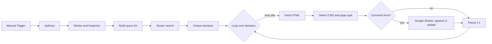

# Blog Comment Prospecting (n8n)

n8n workflow that searches Google through the Serper API for blogs in given niches, checks each site for its CMS, blog signals and an open comment form, and writes the results to Google Sheets with a status.

[Описание на русском](#на-русском)

## How it works

1. Each niche (for example `casino`, `sport betting`) is combined with search footprints such as `"powered by wordpress" "leave a comment" blog`. Three niches and five footprints give 15 queries.
2. Search results are de-duplicated by domain.
3. Each page is downloaded with a 10 s timeout; a failed download does not stop the run. A Code node then applies heuristics:
   - CMS: WordPress, Ghost, Blogger, Joomla, Drupal, Bitrix, TYPO3, MODX, Tilda;
   - forum or blog: phpBB, vBulletin, XenForo and similar signatures versus `article:published_time`, category tags and blog paths;
   - whether a comment form is present and whether registration is required to comment.
4. Sites with a comment form go to Google Sheets with the columns `url`, `cms`, `has_comment_form`, `requires_registration`, `niche`, `status`, `checked_at`. Rows are matched by `url`, so a repeated run updates them. The status is `ready_to_contact` for a blog with an open form that needs no registration, otherwise `needs_review`.
5. A 2-second pause between sites keeps the load on target sites low.

## Stack

n8n · Serper API · Google Sheets API · JavaScript (Code nodes, regex heuristics)

## Setup

1. Import `1_Donor_Blog_Comment_Prospecting_Agent.sanitized.json` into n8n.
2. Put your Serper API key in the **ApiKeys** node. It is safer to use a Header Auth credential with the `X-API-KEY` header.
3. Connect a Google Sheets OAuth2 credential and select a sheet with the seven columns listed above.
4. Edit niches and footprints in the **Задать ниши и запросы** node (node names are in Russian).

## На русском

n8n-воркфлоу для поиска блогов, где можно оставить комментарий. Ниши комбинируются с поисковыми футпринтами, поиск идёт через Serper API, домены очищаются от дублей. Каждый сайт скачивается и проверяется эвристиками: CMS, блог или форум, есть ли форма комментариев и нужна ли регистрация.

Результат пишется в Google Sheets со статусом `ready_to_contact` или `needs_review`. Между сайтами стоит пауза 2 секунды, чтобы не нагружать площадки.
